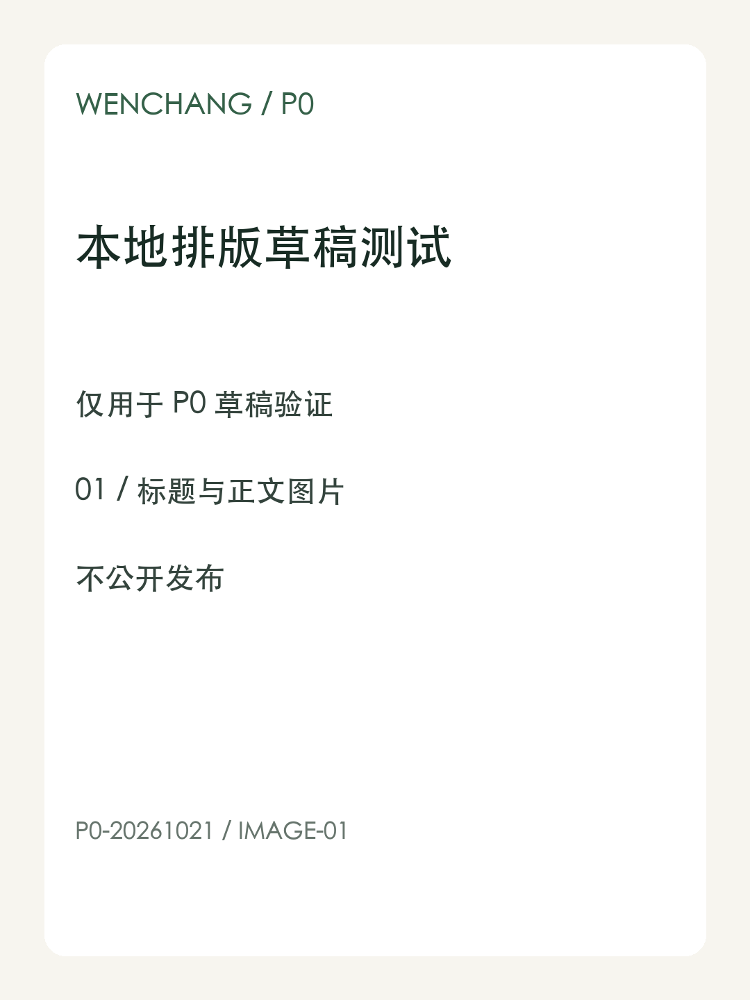
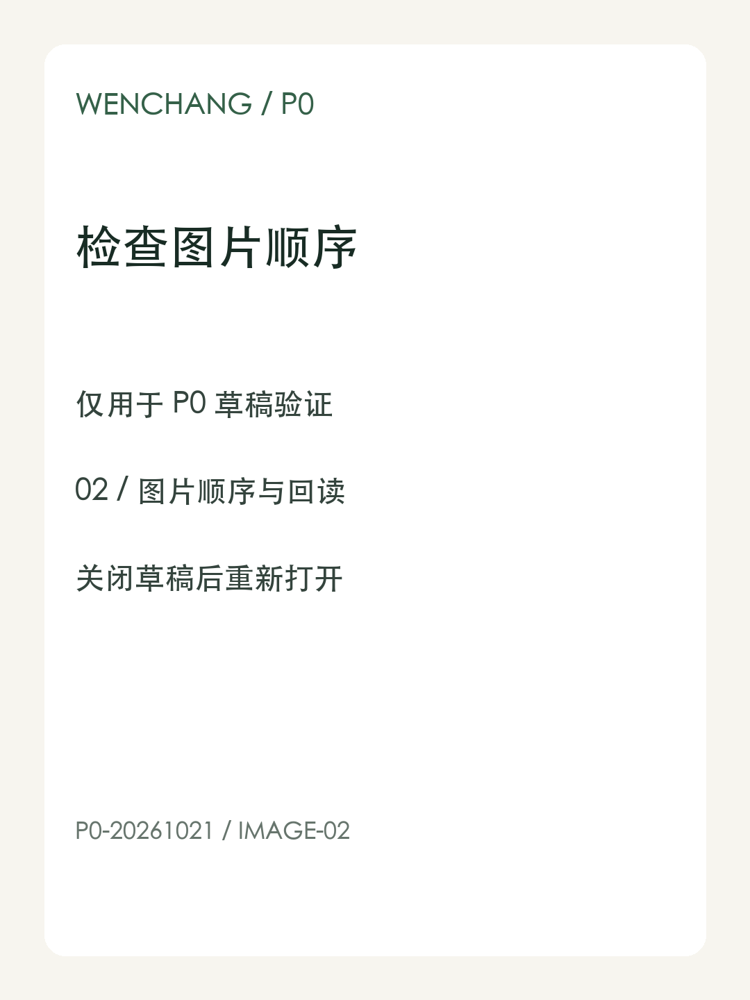

# 文昌P0草稿同步测试

本文是文昌本地内容工作流的合成排版样稿，仅用于平台草稿验证，不公开发布。

## 验证正文与图片

测试标记：P0-20261021-BEGIN。中文标点：逗号，句号。引号“保留”；编号 A-01。

这是**加粗内容**，用于检查编辑器是否保留必要的文本格式。



1. 检查标题和段落。
2. 检查图片数量与显示顺序。
3. 关闭后重新打开草稿。

> 这段引用只用于排版验证，不代表外部事实或效果承诺。

## 验证结构与末尾标记

| 检查项 | 预期 |
| --- | --- |
| 图片顺序 | 01 在前，02 在后 |
| 草稿回读 | 标题、文字与图片完整 |

```text
status = draft_test_only
publish = false
```

示例链接：[Example Domain](https://example.com/)。



测试标记：P0-20261021-END。本文到此结束。
