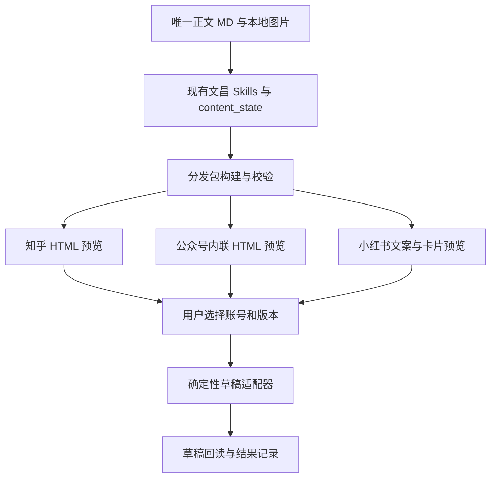

# 文昌本地三平台排版、预览与草稿同步实施方案

创建日期：2026-10-21；进展核对：2026-10-26（Asia/Shanghai）

状态：本地三平台分发、草稿同步与恢复的主路径已有实现；P4 工作台保持只读。以下是 2026-10-26 的实现快照，A/B/C 整理尚未提交或推送。第 1–12 节保留初始方案背景，涉及交互界面、统一适配器和后续能力的设计不代表已全部实现。

### 当前能力与验收缺口

| 范围 | 已核对的本地实现或历史实测 | 剩余条件 |
| --- | --- | --- |
| 本地分发 | 唯一 Markdown 引用、三平台配置与预览、资源哈希、过期检测、失败保留上版、离线导出和 content_state 包引用 | 本地重建不产生新的平台验收 |
| 公众号 | API 草稿保存与回读、同ID更新、完整快照冲突保护及不确定写入对账；历史已审新快照对账和两次不变重跑通过 | API 不独立证明账号对应关系和后台视觉；不宣称原外层 CSS 完整恢复 |
| 知乎 | R2 图片映射、现有草稿导入、保存及独立重开；历史已核对两图的顺序、尺寸和视觉 | 浏览器仍需受控编排；当前 CLI 仅接受与当前 plan 同 hash 的基线 |
| 小红书 | 日常 Chrome 中保存并重开既有草稿，核对六图、分段正文和已选话题；历史用户已确认同配置重启后可见 | 不推定手机端、跨设备或其他浏览器可见；不同 plan 的基线迁移未实现 |
| 只读工作台 | 展示 bundle、平台状态、基线提示、实际文件路径、缺失项、预检命令、预览与恢复动作 | 不提供草稿保存、核验执行或发布按钮，CLI/受控浏览器路径保持独立 |
| 安装交付 | 新增 --with-publishing 白名单源码包、逐文件清单及一致性校验；干净目录离线安装、构建和回归已通过 | 默认内容包保持原范围；现存v0.1未更新，用户本机安装副本一致性仍待补 |

平台历史回执只证明记录时点的验证范围。公众号呈现经用户确认后才采用新快照；知乎图片的 DOM 和视觉核对不等于像素级一致；小红书持久性结论仅限已核验的 Chrome 配置。P0 的早期图片失败不覆盖后续成功，后续历史成功也不能代替当前线上复查。正式稿、账号记录、截图和运行证据继续留在本地，不作为公开文档依赖。

### A/B 的实现边界与本地验收

- 知乎/小红书 CLI preflight 必须将 `evidence.plan_hash` 与当前分发包计划的 `sha(json(plan))` 比较。同目录或 Chrome 父目录找到的 `plan.json` 仅按原始字节 hash 作额外校验；独立导出的 evidence 没有相邻计划时，也不放宽当前计划绑定。
- 不同 plan 的旧 evidence 返回 `BASELINE_EVIDENCE_PLAN_MISMATCH`。保留草稿和旧证据，先审阅版本差异；当前没有跨计划基线迁移或强制覆盖入口，不修改旧 hash 来制造新验收。命令示例与错误处理见[分发工具说明](../../tools/wenchang-publishing/README.md)。
- 任务卡区分当前 transfer 目录不存在、文件存在、文件缺失和路径不可用。安全存在的 `evidence.json` 与 `chrome/evidence.json` 分别显示真实相对路径；evidence 文件存在只表示待预检。公众号使用 API journal 和回执，不推测 `transfers/wechat/` 路径。
- 父目录和末端文件均拒绝符号链接。私有 transfer 文件 GET/HEAD 返回 404，工作台 POST/PUT/PATCH/DELETE 返回 405；页面读取不修改文件内容、修改时间或链接目标。
- 最近一次 A/B 本地回归为 2026-10-26：完整工具 145/145，其中构建、预览和工作台测试 21/21；build、typecheck 和 `git diff --check` 通过。运行时合成夹具覆盖五层符号链接、真实/缺失文件状态、隐私哨兵与请求前后文件快照；HTTP 测试需允许本机回环监听。
- 上述测试不登录、不上传、不保存真实草稿、不发布；C 仅整理说明，不刷新线上状态。Skills 和打包的历史验收与本轮 A/B 工具回归分别记录。

### 后续推进顺序

1. 审阅 A 的计划绑定修复、B 的只读任务卡和 C 的配套说明，按批次保留精确 diff；未获提交指令前不暂存、提交或推送。
2. 公众号后续改稿继续执行完整快照冲突保护；知乎/小红书遇到不同计划的基线，先明确审阅迁移方案，保持现有草稿。最后一次读取与远端写入之间仍有并发窗口，不宣称原子比较写入。
3. 工作台继续保持只读，展示平台预览、基线提示和下一步命令；prepare/verify 由独立 CLI 和受控浏览器执行。
4. 可选源码交付包的文件清单、解压校验和两种打包入口保护单独审查；用户本机安装副本一致性仍待补。模板管理、卡片自动导出、Obsidian、更多平台与云端扩展后置。

人工验收尚未完成时，可以继续状态汇总、打包和离线验证。涉及新外部写入、远端覆盖、浏览器关闭或不可逆操作时，先说明具体对象和影响，再由用户判断。

## 1. 本轮决策

以本地 Markdown 和图片文件为资产底座，复用文昌 Skills 生成平台产物，增加确定性的渲染、检查、草稿同步与回读模块。先验证一篇文章的三平台闭环，再提供统一的本地网页工作台，全程不依赖 Obsidian。

首版默认范围：

| 平台 | 内容类型 | 排版与预览 | 完成标准 |
| --- | --- | --- | --- |
| 知乎 | 专栏文章 | 保留正文，适配标题、图片、代码、表格与引用 | 草稿可重新打开，标题、正文和图片核验通过；编辑前须有与当前 plan 绑定的已审独立回读基线 |
| 公众号 | 普通长文图文 | 单一主题、内联样式 HTML、正文图片和独立封面 | 草稿可回读，并在公众号后台复核显示 |
| 小红书 | 图文笔记 | 独立发布文案、双标题、3:4 卡片及排序预览 | 当前账号指定草稿位置可重新打开，文案和图片完整；编辑前须有与当前 plan 绑定的已审独立回读基线 |

本期交付到草稿保存和核验；正式发布继续由用户决定。知乎回答、公众号图片消息、视频、定时发布、跨设备自动同步、数据复盘和多人 SaaS 留到后续迭代。

现有 [Studio PRD](wenchang-studio-v1.md)、[执行协议](wenchang-studio-v1-execution-protocol.md)、[线框](wenchang-studio-v1-wireframe.md) 描述云端控制台加本地 Runner，且明确排除了平台账号和发布接口。本方案是面向个人自用的独立本地试点，不将旧方案视为已实现，也不直接修改旧协议的发布边界。未来产品化再复用试点验证过的产物合同和适配器。

## 2. 仓库现状与复用边界

以下判断来自本次文件与源码检查；脚本存在、语法有效、平台文档宣称支持，均不能代替真实草稿验收。

| 现有资产 | 可以复用 | 需要补齐 |
| --- | --- | --- |
| [文昌总控](../../content/wenchang-orchestrator/SKILL.md)、[路由](../../content/wenchang-router/SKILL.md) | 已有正文可直达出刊及草稿操作手册，不重跑研究和起稿 | 自动发现既有分发包并集中显示缺失项 |
| [写作](../../content/wechat-writing-skill-ai-human3/SKILL.md)、[诊文](../../content/wenchang-review/SKILL.md)、[出刊](../../content/wenchang-publish-check/SKILL.md) | 正文、最小修改、标题摘要、平台检查 | 让出刊报告引用实际文件、版本和平台校验结果 |
| [content_state](../../content/CONTENT_STATE.md) 与 [schema](../../content/content_state.schema.json) | `draft`、`publish_assets`、`distribution.package_ref`、`decisions`、`handoff`；已补分发包引用说明 | 统一状态入口不自动推进审核或发布状态，保持旧任务兼容 |
| [redbook-cards](../../content/redbook-cards/SKILL.md) | 小红书 HTML 卡片规划与预览规则 | 固定主题、统一可截图结构、离线字体、溢出检查 |
| [小红书 v4](../../content/xiaohongshu-viral-image-skill-v4/SKILL.md) | 更完整的图片集结构、视觉 brief、逐页提示词和发布文案 | 首版按需要调用；HTML 卡片路线无需默认运行全部生图流程 |
| [卡片生成器](../../content/long-to-cards/scripts/card-gen/generate_cards.py)、[截图脚本](../../content/long-to-cards/scripts/screenshot_cards.js) | 1080×1440 卡片尺寸、HTML 到 PNG 思路 | 字体/图片就绪等待、页面无裁切、图片顺序、依赖锁定；重新验收后接入 |
| [公众号适配器](../../tools/wenchang-publishing/src/wechat-sync.ts) | 固定官方接口、正文图/封面上传、草稿新增/回读、journal 幂等及写入不确定保护 | 原草稿更新与显式对账；后台视觉验收；保持凭据不出本机私密目录 |
| [小红书脚本](../../content/long-to-cards/scripts/publish/publish_xiaohongshu.py) | 创作者编辑流程的参考 | 身份核验、准确选择器、持久草稿证据、失败状态；现有默认将 Cookie 写在脚本目录旁，不能直接接入新工作台 |
| [知乎适配器](../../tools/wenchang-publishing/src/zhihu-sync.ts) | 已实现 R2 映射、指定已有草稿导入、等待保存、独立回读和证据核验 | 通用浏览器编排、远端修改保护和跨运行恢复 |
| [Studio 文档](wenchang-studio-v1.md) | 阶段、人工决策、产物来源的概念 | 本次未发现对应应用工程；本地界面与执行服务需要实现 |

Skills 主源沿用 `content/<skill>/`；接入时核对 `.codex/skills/` 对应副本和打包清单。新增平台校验由共享配置与脚本执行，避免给三个平台分别复制写作 Prompt。

## 3. 用户操作路径

1. 选择已有 Markdown 或文昌任务目录。自动读取正文、已确认标题、图片和 content_state；缺失项集中显示。
2. 勾选知乎、公众号、小红书。默认沿用正文，仅在平台要求不同的位置生成衍生内容。
3. 生成三平台预览。公众号看长文排版，知乎看内容兼容性，小红书看发布文案、封面和有序卡片。
4. 局部修改并保存。正文修改回唯一正文文件；小红书文案和卡片修改保存到衍生文件。系统提示受影响的旧预览。
5. 选择账号，点击“保存到所选平台草稿”。操作范围绑定本次平台、账号和产物版本，可一次处理多个平台。
6. 逐平台显示结果和“打开草稿”。失败平台单独处理；已成功的平台保留结果。

用户不必输入 skill 名称、JSON、端口或文件哈希。高级详情提供来源、版本、检查项和失败诊断。

## 4. 本地架构与技术选择



- 内容生产继续复用现有本地 Skills 和任务入口；首轮可从当前 Codex 工作流执行，无需先实现完整 Runner。
- 工具层推荐 Node.js + TypeScript，负责文件、渲染合同、校验和适配器；现有 Python 工具在需要时作为子进程调用，不为统一语言重写。
- 首轮先有本地 HTML 产物和命令入口；三平台探针通过后增加 Vite + React + TypeScript 界面，由单一本地 Node 服务提供文件和任务 API。首次落代码时再锁依赖版本。
- 直接保存 JSON 状态与文件产物。首版单任务写入队列和原子文件替换足够，不引入云数据库、账号系统、消息队列或云 Runner。
- 服务只监听回环地址。预览 iframe 禁止执行文章脚本；HTML 使用明确的标签/属性白名单。写操作校验会话凭证和请求来源，文件访问限制在用户选定工作区。

### 外部工具的使用方式

**公众号排版：以 doocs/md 作为首选排版对照与候选复用来源。** 官方文档提供 Markdown 渲染、主题、文件导入导出与本地部署；尚未验证可供本项目直接调用的稳定渲染 SDK/API。P0 验证可抽取的渲染入口与主题许可；可复用则封装并锁版本，只有编辑器交互入口时先使用本地实例对照，并实现小范围 Markdown 到内联 HTML 的渲染层。不能把一个编辑器 URL 当作无头转换接口。[项目文档](https://github.com/doocs/md)

**知乎同步：优先验证 Wechatsync 扩展 + CLI。** 官方 CLI 提供 Markdown 同步和 dry-run，MCP 文档描述草稿工具；先封装 CLI 减少常驻连接，后续确有统一工具需求再接 MCP。主 README 与子模块的平台列表有差异，公众号、小红书的具体路径仍列为待验证。[CLI 文档](https://github.com/wechatsync/Wechatsync/blob/v2/packages/cli/README.md)、[MCP 文档](https://github.com/wechatsync/Wechatsync/blob/v2/packages/mcp-server/README.md)

扩展使用支持的 Chrome/Edge 会话。Codex 内嵌浏览器不预设可以加载该扩展，登录态也不预设互通。先确认兼容浏览器、账号与配对；禁止把 Cookie 复制进内容仓库。CLI 文档描述的远程桥接会监听所有网卡，本试点只接受已核验的回环绑定方案；若所选版本不支持，先使用扩展界面或替代本地适配器，不开启远程桥接。[桥接说明](https://github.com/wechatsync/Wechatsync/blob/v2/packages/cli/README.md#远程桥接)

## 5. 单一正文源与最小产物合同

新项目建议目录如下；已有文章用 `source_ref` 引用原路径，不批量搬迁或复制正文。

```text
content/outputs/<content-id>/
  body.md                         # 唯一可编辑的主正文
  assets/                         # 原始图片、封面、GIF
  content-state.json              # 现有文昌接力对象
  distribution/
    bundle.json                   # 输入、产物、素材与版本索引
    platforms/
      zhihu.json                  # 标题、正文来源、格式降级记录
      wechat.json                 # 标题、作者、摘要、封面、主题
      xiaohongshu.json             # 双标题、描述、标签、卡片顺序
    derived/xiaohongshu-cards.json # 卡片内容的可编辑衍生源
    builds/<bundle-version>/      # 可再生、不可手工维护的渲染输出
      zhihu/article.html
      wechat/article.html
      xiaohongshu/preview.html
      xiaohongshu/images/01.png
      checks.json
    attempts/<attempt-id>.json     # 保存草稿的结果、目标和证据索引
```

正文和图片在离线状态仍能打开，预览所需样式和字体不依赖外网。模板内的远程字体改用本地可用字体或许可允许的随包字体；不要为统一字体而扩大安装范围。

`bundle.json` 只需承载：

| 字段 | 含义 |
| --- | --- |
| `schema_version`、`content_id` | 合同版本和稳定内容标识 |
| `source_ref`、`source_hash` | 正文来源与字节摘要，避免双份正文 |
| `bundle_version`、`built_at` | 冻结的产物版本和构建时间 |
| `platforms` | 目标平台、元数据来源、渲染文件、检查报告、渲染器与模板版本 |
| `assets` | 本地路径、类型、字节数、尺寸、文件摘要及显示顺序 |

`bundle_version` 由正文、图片、平台配置、卡片内容及渲染器/模板版本共同决定。任何输入变化都使相关预览及审核状态过期。只更改小红书描述时，只重建小红书产物。

本地正文的相对图片路径长期保留；平台图片 URL 仅写入该账号的上传映射和传输副本。渲染输出是可再生缓存，发布包只维护引用。预览、用户确认、上传都绑定同一构建版本。

在既有 `content_state.distribution` 增加可选 `package_ref`，指向分发包；`publish_assets` 沿用现有发布字段，`decisions` 记录用户选择。同步尝试详情单独存储，避免把传输日志塞进文昌上下文。实施时同时更新状态文档、schema 和兼容 fixture，保持已有字段含义和旧任务可读性。

## 6. 三平台的排版、预览和同步策略

### 知乎：先专栏文章

- 主体引用唯一正文，默认只适配标题和元数据；回答模式留待显式选择问题后再扩展。
- 渲染标题、列表、引用、链接、代码与表格；公式、Mermaid、复杂表格等遇到不支持项时输出可见降级说明。必要时生成本地图片，禁止静默丢内容。
- 图片先验证源文件和可上传性，再由已通过探针的适配器处理上传与正文替换。
- 同步首选 Wechatsync。必须验证所选版本是否保留本地图片、是否会重新解析 HTML、是否返回草稿标识及编辑入口；HTML 被改写时按实际传输路径修正预览。
- 优先复用已存在的远端草稿；若适配器只支持新建，明确显示“新建一份草稿”，不承诺自动更新。降级路径为打开创作编辑器、填入排版内容并保存，随后重新打开核验。

### 公众号：API 权限决定传输路径

- 选择一个固定主题，将 Markdown 生成内联样式 HTML。封面独立于正文图片，正文默认不重复 H1 标题；摘要、署名独立配置。
- 本地预览使用与待传输内容相同的结构和样式，仅图片地址在上传后替换；最终以微信后台处理后的显示验收。
- 路径 A：账号具备相应接口权限时，复用公众号脚本骨架，补齐正文图上传、封面素材、创建/更新草稿和回读详情。凭据由本地服务的安全存储读取，不传入前端、命令行参数或日志。
- 路径 B：无对应权限或配置条件不成立时，使用网页编辑器保存。复制富文本和上传图片后核对后台结果；手工保存可作为明确标记的降级路径。
- P0 实查账号的草稿、图片、素材接口和网络配置要求，再决定 A/B。不能从账号名称或第三方文章推断权限。同步完成要有草稿标识/编辑入口、回读结果及后台预览证据。
- R2 等公共图床保留可选，草稿链路不强制公开上传。GIF、SVG、超大图的支持和转换规则按实际接口验证；如需要转为静态图，预览中先显示转换结果与说明。

本次微信官方草稿文档访问失败，尚未据此确认最新权限和媒体限制。现有脚本可证明仓库实现了 `draft/add` 调用，不能证明当前账号可用；相关官方入口列在文末作为 P0 核对项。

### 小红书：图文卡片和可持久保存的草稿

- HTML 卡片优先复用 `redbook-cards` 的内容规划，结合现有 1080×1440 生成器和截图工具；先固定一种视觉主题，卡片数量按内容决定，默认建议 8 页，允许缩短，不凑页。
- 完整图片集或 AI 插画需求再调用 v4。图文卡片和提示词生成各走一次明确路线，避免同一内容重复加工。
- 工作台同时预览封面主标题、发布标题、描述、话题和有序卡片。沿用项目约定：封面主标题 5–20 个 Unicode code points，发布标题不超过 20 个，两者不完全重复；独立描述 150–300 个 code points。以上是编辑验收约定，平台实际字段限制另在 P0 核对。
- 小红书专属校验优先于旧通用卡片模块的标题/字数建议；历史已冻结内容不自动回填。把规则集中到平台配置，Skills 输出后再统一校验。
- 导出 PNG 前等待字体和图片加载，检查所有卡片的内容溢出、尺寸、裁切与页序；HTML 页面能打开不等于图片已验收。
- 先探测扩展/创作者后台对“图文笔记 + 多张本地图片 + 保存草稿”的支持，再选择扩展或网页路径。不得把 Markdown 长文同步能力直接当作图文笔记能力。
- 必须记录草稿保存位置：平台云端、当前浏览器本地，或仅编辑页已填入。只保证实测可重开的范围，不默认手机端可见或跨设备同步。
- 浏览器本地草稿需在重启相同浏览器和配置后再验证；只存在于当前编辑页时标记 `editor_filled`。没有可持久重开的草稿，MVP 的小红书同步验收不通过，可继续交付本地素材包。

## 7. 草稿适配器与成功定义

适配器统一暴露能力检查、本地准备、保存草稿和回读核验；具体方法名在实现时确定。能力矩阵至少包含 `can_create`、`can_update`、`can_verify`、`draft_storage` 和 `supported_media`，未探测的能力记 `unknown`。

确定性工具层负责上传和保存；文昌 Skills 负责内容与出刊判断。发布检查通过只表示内容准备就绪，不自动创建外部草稿。用户对已指定账号、平台和版本的同步指令可复用，不为同一操作逐张图片重复询问；本轮仅规划，不执行外部写入。

状态分为两组：

- 构建：`building → local_ready → needs_review → approved`；源文件变化后为 `stale`，缺失素材则为 `blocked`。
- 传输：`not_started → syncing → draft_saved_unverified → draft_verified`；另有 `editor_filled`、`failed`、`unknown`。

`draft_verified` 的必要条件：账号身份相符、草稿重新打开、标题和关键正文核对、图片数量/顺序/显示核对、保存位置明确、记录验证时间。平台规范化 HTML 后比较可见内容与结构，不要求回读字节完全相同。API 路径要保存回读数据，网页路径要保存本地核验截图和可重开入口。

每次传输记录平台、非敏感账号别名/标识、`bundle_version`、`attempt_id`、适配器版本、远端 ID/编辑入口、保存位置、错误与证据路径。截图和账号记录默认留在不进入 Git 的本地运行目录；不记录凭据或 Cookie。正式发布状态只能由后续独立核验回填。

重试与冲突：

- 相同账号、平台、内容版本已有已验证草稿时，默认打开原草稿，不重新创建。
- 请求超时可能已保存成功时标记 `unknown`，先查远端；不能盲目重复创建。
- 已有 ID 且确认支持更新时才更新；远端有用户修改时先显示差异，由用户选择保留或覆盖。
- 一个平台失败不回滚其他平台。保留成功结果，按失败平台单独重试。
- 登录失效、账号不符、验证码或权限不足时提供具体下一步；完成登录后恢复原任务，不重跑写作。

## 8. 分阶段实施清单

P0 在完整界面前执行，优先暴露账号和草稿语义问题。各平台单独记录结果，小红书阻塞不妨碍公众号和知乎继续；三平台全部通过才宣称本期闭环完成。

| 阶段 | 工作与交付 | 通过条件 |
| --- | --- | --- |
| P0：能力探针（已完成） | 已建立历史能力报告、固定版本和三平台探针；小红书当时失败已保留 | 各平台首选路径或阻塞证据已取得；不等于任意正式稿通过 |
| P1：本地分发包（已实现并验收） | manifest/schema、配置、预览、校验、content_state 引用和有序卡片导出 | 本地离线预览、打包和过期检查通过；不代表线上成功 |
| P2：知乎与公众号（主路径可用） | 公众号 API 新增/回读、知乎 R2+浏览器独立重开已有历史验收；恢复状态、失败回执和导入前基线预检已补 | CLI 基线须绑定当前 plan；不同计划的旧 evidence 保留阻塞，迁移另行审阅 |
| P3：小红书（原生适配与 Chrome 独立重开通过） | 六图、199字文案、4话题、顺序、保存列表及重启后人工重开确认已补入正式进展；恢复状态、失败回执及导入前基线预检已补 | 仅保证该浏览器配置本地草稿 |
| P4：统一工作台与回归 | 只读 `/workbench` 任务卡展示版本、平台状态、基线、实际文件路径与缺失/不可用状态、预检命令、预览和恢复提示；五层符号链接与只读 HTTP 边界已验收 | 不提供页面执行入口；本地回归不替代当次真实草稿回读 |

P0 用测试草稿探测必要外部行为，先核定文章和目标账号。测试后保留草稿供查看，不自动清理。内容采用用户自己的可测试稿或合成样稿，不使用刚下载的他人文章作为试发内容。

P0 的排版样稿先用已有卡片工具、doocs 本地实例或简单 HTML 手工准备，无需等待 P1 分发包工程；P1 再将已验证路径固化。探针中任何平台只有“编辑器已填入”而无法重开草稿时，都保留为阻塞，不把降级交付计作该平台同步完成。

工作量粗估：单开发者、已有模型与浏览器环境时约 8–12 个有效开发日。账号申请、验证码、接口权限及平台改版时间另计；P0 后按实际可用路径重新估算，不作为交付日期承诺。

## 9. 拟改动位置

以下文件在实施阶段创建或更新，本次规划不提前搭建工程。

| 位置 | 工作 |
| --- | --- |
| `tools/wenchang-publishing/`（新增） | bundle 构建、平台渲染、草稿适配器、校验、本地服务和最小 React 界面；同一工程共享合同 |
| `content/publishing/`（新增） | 平台编辑约定、唯一首版主题、卡片配置规范、能力报告与使用说明 |
| `content/fixtures/local-publishing/`（新增） | 中文正文/路径、图片、复杂格式、过期版本和失败恢复的合成样例 |
| `content/CONTENT_STATE.md`、`content/content_state.schema.json` | 增加可选分发包引用；保持旧任务兼容 |
| `content/wenchang-publish-check/` 及对应 `.codex/skills/` | 输出真实预览/校验引用，将草稿执行交给工具层 |
| `content/wenchang-orchestrator/`、`content/wenchang-router/` 及对应副本 | 补“已有文章 → 排版/分发包”入口，保留现有阶段边界 |
| `content/long-to-cards/scripts/` | 必要时局部补截图或上传能力；待新适配器通过验证后再决定旧入口如何兼容 |
| `scripts/validate_skills.sh`、`scripts/validate_content_fixtures.py` | 接入新增合同和样例；保留原有检查 |
| `README.md`、`docs/wenchang-user-guide.md`、打包清单 | 本地启动、依赖、账号配对、故障恢复和分发说明 |

新功能放在独立目录，先通过新入口启用；旧 Skills 仍能直接运行。已有任务无新字段时正常读取；适配器不可用时保留本地预览和导出。失败构建不覆盖上次成功构建。

## 10. 验收样例与完成标准

先准备一篇合成排版样稿，再选一篇用户自己的已完成文章做端到端测试；三平台使用同一版本的正文来源。

样稿覆盖：中文和空格路径、标题层级、加粗、列表、引用、链接、代码、宽表格、本地 PNG/JPEG/GIF、缺图及不支持格式。复杂格式必须保留、显式转换或阻塞，不能默默消失。

| 验收项 | 证据 |
| --- | --- |
| 资产可迁移 | 移动完整项目目录后相对路径有效；断网仍能预览，源文件未被平台 URL 替换 |
| 正文唯一 | 公众号/知乎由源文件构建；小红书衍生版本可追溯，发布包不复制全文维护 |
| 排版可靠 | 三平台本地视觉核对；小红书卡片为 3:4、不低于 1080×1440，保留合规原图字节和实际尺寸，无溢出、顺序正确 |
| 草稿真实 | 每个平台重新打开后核验；记录 ID/入口、账号、保存位置、时间和证据 |
| 状态诚实 | API 返回、编辑器已填入、草稿已保存、回读已通过分别显示 |
| 版本一致 | 修改正文、图片或主题后，旧预览和批准失效；上传旧版本被阻止 |
| 基线绑定 | evidence 必须匹配当前 plan；同目录/Chrome 父目录计划作额外校验，独立导出不放宽绑定，跨计划证据阻塞 |
| 工作台只读 | 实际文件状态可见；五层路径链接不被跟随；私有文件 GET/HEAD 返回 404，写请求返回 405；临时夹具请求前后文件快照不变 |
| 可恢复 | 登录过期、上传失败、写入超时、远端人工修改、单平台失败均有明确恢复路径 |
| 保留判断 | 所有集成测试验证没有调用正式发布/群发动作；用户能单独审阅每个平台 |

实施后的验证层次：

1. 静态与单元：manifest/schema、路径解析、标题长度、资源哈希、格式降级、账号/版本绑定、状态转移和超时结果分类。
2. 本地视觉：预览与截图共用构建产物，验证字体、图片、卡片溢出和离线资源；一次固定主题验收后不重复生成多套风格。
3. 模拟适配器：验证不重复创建、回读失败不报成功、失败不污染其他平台；确认正式发布能力不可调用。
4. 真实账号：每个平台创建并重新打开一份测试草稿，核验实际可见内容；小红书按保存位置验证持久性。
5. 仓库回归：运行 `./scripts/validate_skills.sh` 和新增工具的 test/typecheck/build；更改现有接力对象时复跑内容 fixtures。

仅通过本地测试时交付状态为“本地预览就绪”；只有三个目标平台都满足草稿核验标准，才交付“三平台草稿同步已打通”。

## 11. 当前默认与后续所需信息

默认采用个人本地工作台、知乎专栏、公众号普通长文、小红书图文卡片、单账号/平台和单主题。先保留现有文昌内容入口，待传输验证完成后再做界面整合。

实施 P0 时需要核定三平台的具体账号、公众号可用权限、扩展所在浏览器和一篇允许测试的自有文章。凭据在相应平台或本机安全配置中完成，不要求粘贴到聊天。缺少上述信息时先继续本地产物与模拟验证，不猜测账号身份或写入外部草稿。

## 12. 依据与核验范围

仓库依据见第 2 节链接；本次读取了具体脚本，未实际执行上传或登录。既有 Studio 文档为历史产品设计，不能作为运行状态证据。

外部依据于 2026-10-21 查阅：

- [doocs/md README](https://github.com/doocs/md)：排版能力与本地部署，未验证编程渲染接口。
- [Wechatsync 主 README](https://github.com/wechatsync/Wechatsync)：扩展与多平台同步的产品说明。
- [Wechatsync CLI README](https://github.com/wechatsync/Wechatsync/blob/v2/packages/cli/README.md)：CLI、dry-run、扩展桥接与网络绑定说明；账号可用性待探针。
- [Wechatsync MCP README](https://github.com/wechatsync/Wechatsync/blob/v2/packages/mcp-server/README.md)：草稿工具描述；不据此推定所有平台支持同一内容类型。
- 微信官方文档待 P0 重查：[新增草稿](https://developers.weixin.qq.com/doc/subscription/api/draftbox/draftmanage/api_draft_add.html)、[获取草稿](https://developers.weixin.qq.com/doc/subscription/api/draftbox/draftmanage/api_draft_get.html)、[修改草稿](https://developers.weixin.qq.com/doc/subscription/api/draftbox/draftmanage/api_draft_update.html)。本次抓取失败，最新字段、账号权限和媒体限制尚未核验。

### 本轮 review

- 方案复用现有文昌内容能力，将三平台传输作为独立增量；首版实现范围已经收敛。
- P0 优先验证账号和草稿语义，再决定传输路径，避免先做完整控制台后发现目标平台无法保存草稿。
- 正文源、可编辑平台衍生内容、构建缓存和草稿证据分层；同步、发布与真实传播效果分别记录。
- 本轮交付为方案和待办，未安装工具、未修改 Skills/脚本、未进行账号配对、上传或草稿写入。

## 2026-10-23 P1 实施记录

该历史节点完成唯一 Markdown 引用、三平台配置、版本化预览、过期检查、局部缓存复用、相对资源导出和可选状态接力，记录了 12 项回归及 Skills 校验。卡片复用已有 PNG，HTML 自动截图当时未接入，小红书线上图片仍在排查。证据留在本地；该历史节点不代表当前实现和线上状态，最新工程边界见文首。
